<div align="center">

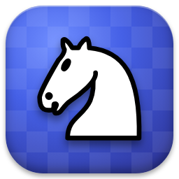

# Шахматный тренер

**Играй, учись и поднимай рейтинг.**
Десктопная программа для Windows на C++: боты разной силы, рейтинг с уровнями как на FACEIT,
разбор партий Stockfish'ом, тренер прямо во время игры, задачи, уроки и эндшпили.


[Скачать](#-установка) · [Возможности](#-возможности) · [Сборка](#-сборка-из-исходников) · [План](#-что-дальше)

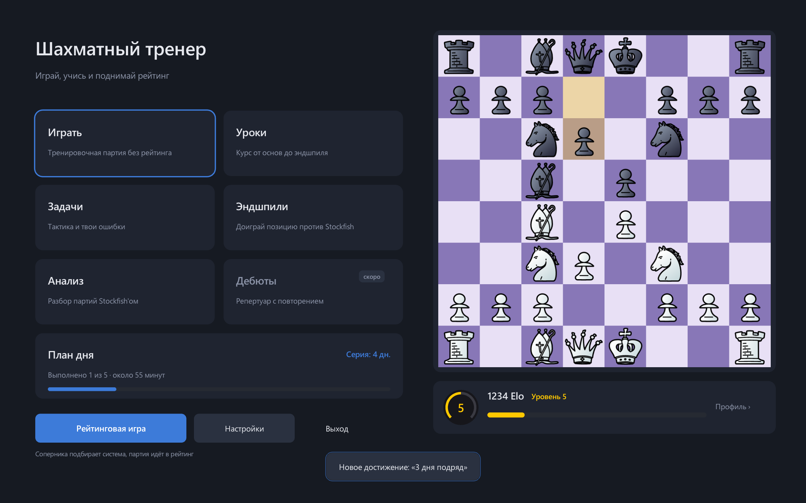

</div>

---

## ✨ Возможности

| | |
|---|---|
| ♟️ **Игра** | Партия с другом или с ботом. Свой движок и 10 ботов с характером — от «Новичка» до «Гроссмейстера», есть «Агрессор», «Позиционщик» и «Тактик» (сильные — на Stockfish). Контроль времени, отмена хода, PGN. |
| 🏆 **Рейтинговая игра** | Как на FACEIT: соперника выбираешь не ты — система сама подбирает бота под твой Elo со случайным стилем игры. Калибровка из 5 партий нащупывает твой уровень: выиграл — дадут сильнее, проиграл — слабее. Уровни 1–10, без подсказок и отмены ходов. |
| 📅 **План дня** | Тренировка на 30–60 минут, собранная под тебя: задачи на слабую тему, следующий урок, эндшпиль, повторение дебюта, рейтинговая партия и её разбор. Пункты отмечаются сами. |
| 👤 **Профиль** | Рейтинг в партиях и задачах, графики, слабые темы, прогресс курса, серия дней и 16 достижений. |
| 🧑‍🏫 **Тренер в партии** | Подсказки в три шага, показ угроз, предупреждение о зевках, дебютные ходы помечены книжкой. |
| 🔍 **Разбор партий** | Stockfish оценивает каждый ход: лучший, неточность, ошибка, зевок. График оценки по ходу партии. |
| 🧩 **Задачи** | 155 000 задач из открытой базы Lichess: рейтинговый режим, темы, «шторм» на время, твои собственные ошибки из партий. |
| 📚 **Уроки** | 44 урока в 12 разделах и 176 задач: от ценности фигур до позиционной игры и расчёта. Каждая задача проверена Stockfish. |
| 📖 **Дебюты** | Готовый репертуар с объяснением каждого хода: Итальянская партия и ответы на сицилианскую, французскую и другие защиты за белых, Каро-Канн и отказанный ферзевый гамбит за чёрных — 89 веток, все проверены Stockfish. Тренажёр с интервальным повторением: программа играет за соперника, ты вспоминаешь свои ходы, ошибки возвращаются чаще. Свои ветки добавляются ходами на доске или из PGN. |
| 👑 **Эндшпили** | Доигрываешь ключевые позиции против Stockfish: мат ферзём и ладьёй, оппозиция, Лусена, Филидор. Цель «выиграй за N ходов» или «удержи ничью». |
| 🎨 **Оформление** | 3 темы (Ночь, Дерево, Арена), 12 наборов фигур с живым превью, наборы звуков. |
| 🔄 **Обновления** | Программа сама находит новую версию на GitHub и обновляется в один клик. |

## 📸 Скриншоты

<table>
  <tr>
    <td>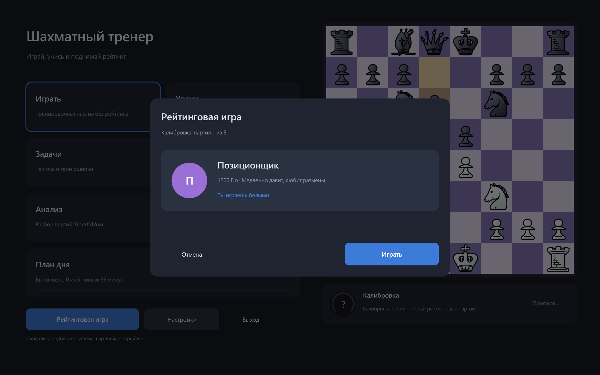<p align="center">Рейтинговая игра: соперника подбирает система</p></td>
    <td>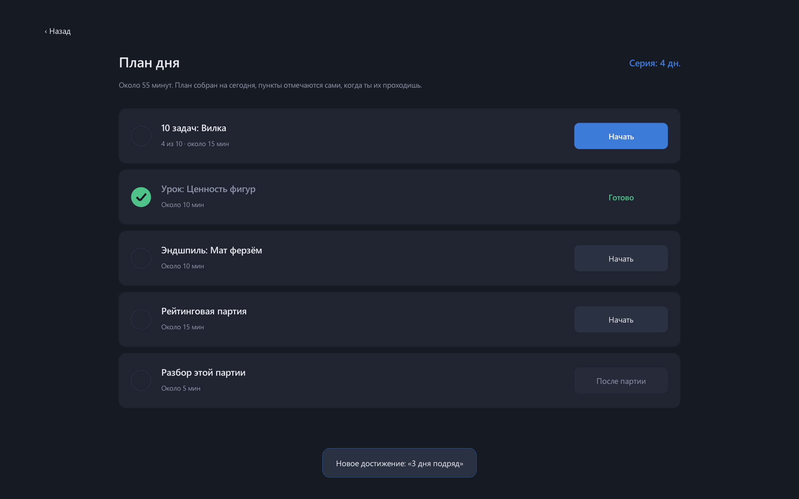<p align="center">План дня</p></td>
  </tr>
  <tr>
    <td>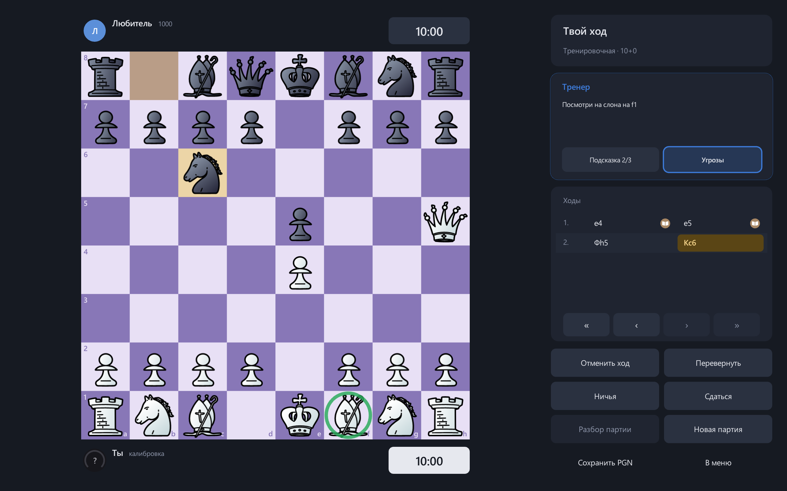<p align="center">Тренер подсказывает во время игры</p></td>
    <td>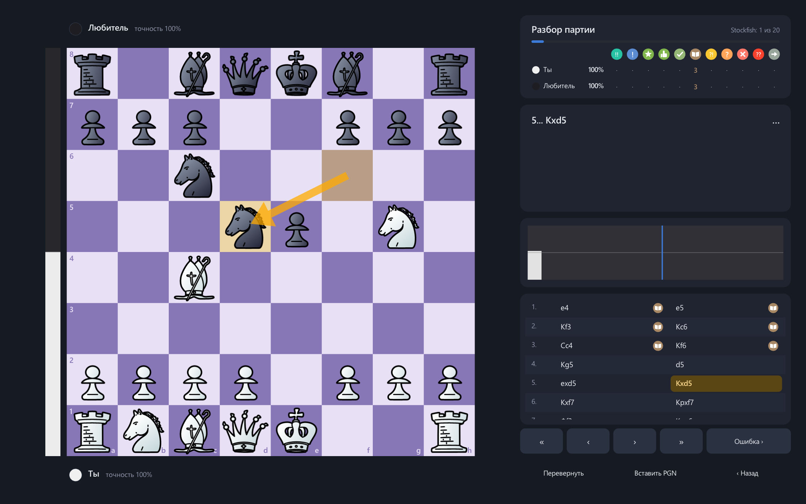<p align="center">Разбор партии Stockfish'ом</p></td>
  </tr>
  <tr>
    <td>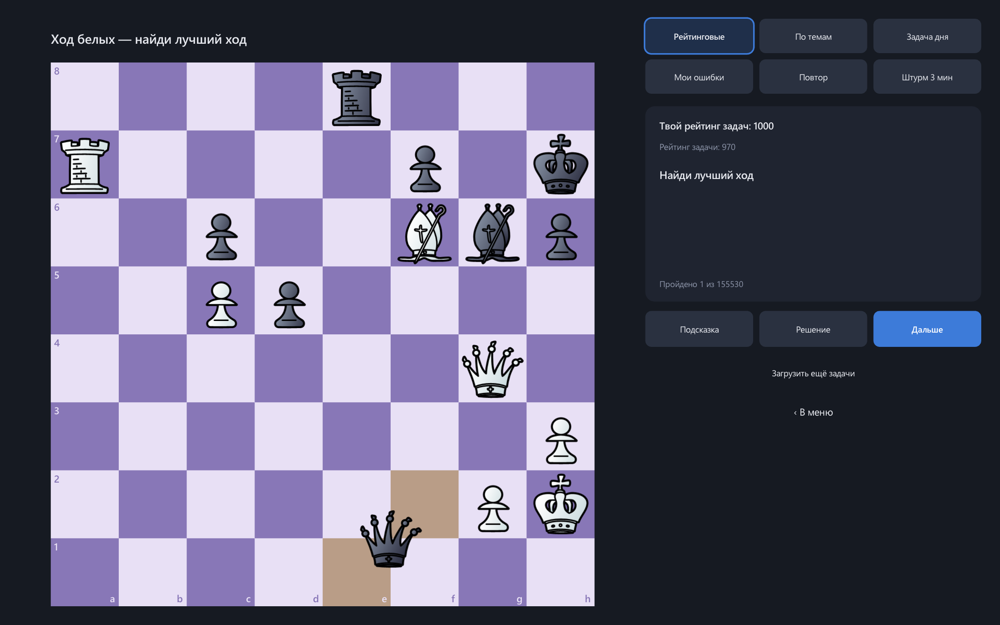<p align="center">Задачи из базы Lichess</p></td>
    <td>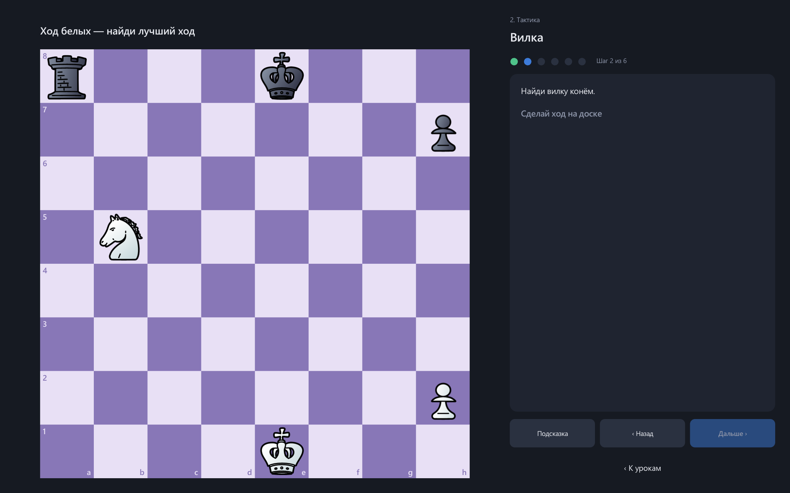<p align="center">Уроки с задачами</p></td>
  </tr>
  <tr>
    <td>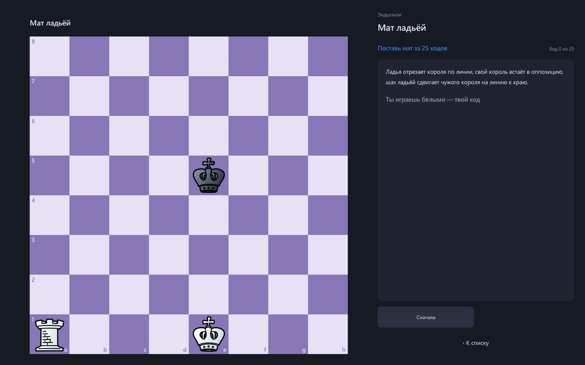<p align="center">Тренажёр эндшпилей</p></td>
    <td>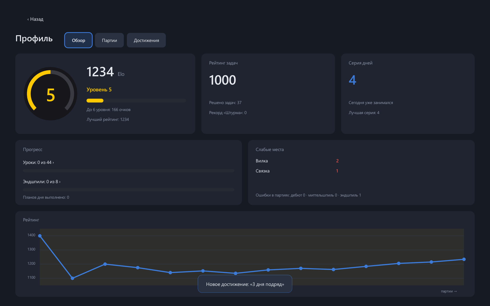<p align="center">Профиль и рейтинг</p></td>
  </tr>
  <tr>
    <td>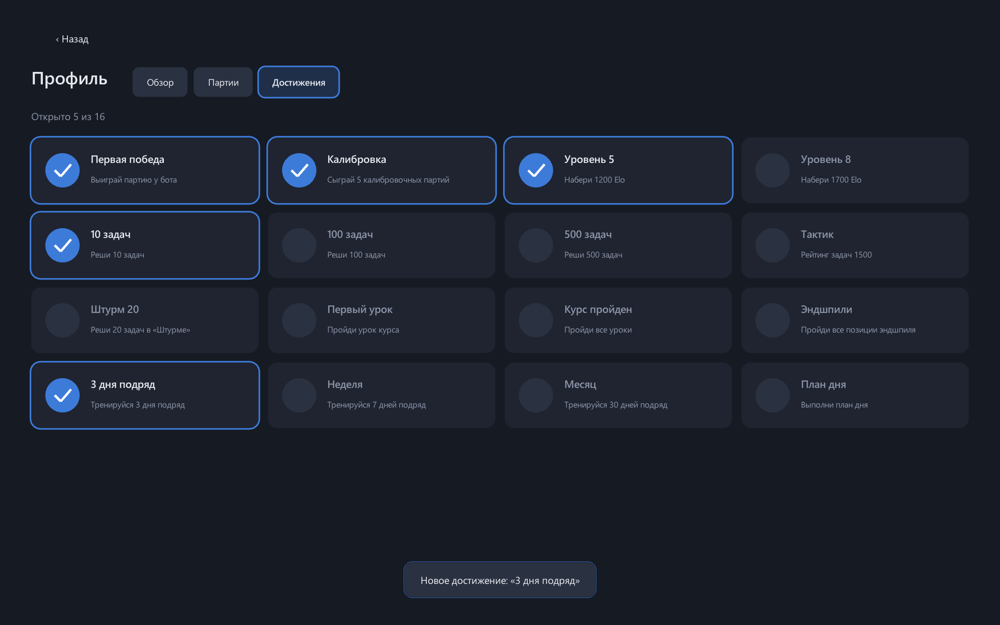<p align="center">Достижения и серия дней</p></td>
    <td>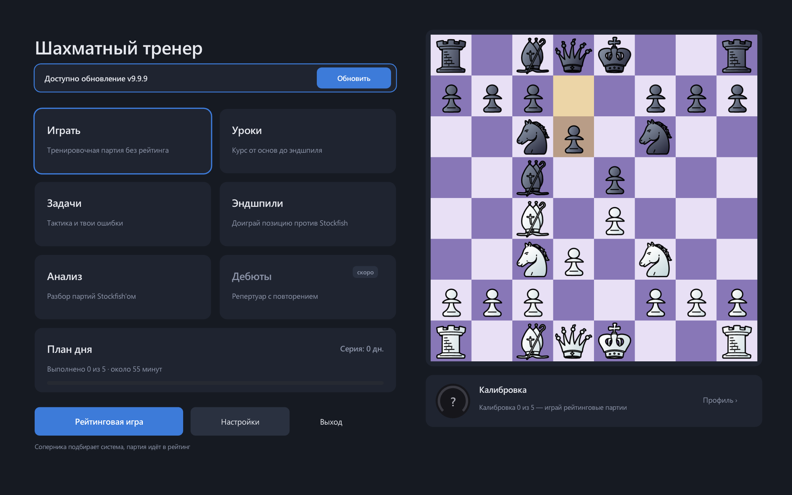<p align="center">Обновление в один клик</p></td>
  </tr>
</table>

## 📦 Установка

1. Открой [Releases](../../releases/latest) и скачай `ChessTrainer-Setup.exe`.
2. Запусти. Права администратора не нужны, программа ставится в `%LOCALAPPDATA%\Programs`.
3. Ярлык появится в «Пуске» (и на рабочем столе, если отметишь).

Visual C++ Redistributable ставить не надо — всё уже внутри.

## 🛠 Сборка из исходников

Нужно: **Visual Studio 2022+** с компонентом «Разработка классических приложений на C++» (CMake входит в него).

```bash
git clone https://github.com/codegyry-crypto/chess-trainer.git
cd chess-trainer
```

Stockfish не хранится в репозитории (слишком большой). Скачай **Stockfish 17.1 для Windows** с
[stockfishchess.org](https://stockfishchess.org/download/) и положи `.exe` в `third_party/stockfish/`.
Подойдёт любая сборка — программа сама выберет AVX2, если процессор его поддерживает.

```bash
cmake -B build
cmake --build build --config Release
```

Готовая программа: `build/Release/ChessTrainer.exe`. Остальные зависимости (raylib, SQLite, zstd) CMake скачает сам.

Тесты:

```bash
ctest --test-dir build -C Release
```

Установщик собирается [Inno Setup](https://jrsoftware.org/isinfo.php): `ISCC installer\ChessTrainer.iss` → `dist\ChessTrainer-Setup.exe`.

## 🗂 Структура

```
src/
├── core/       правила шахмат, FEN, SAN, PGN
├── engine/     свой движок: оценка, поиск, боты
├── coach/      тренер во время партии
├── uci/        общение со Stockfish по UCI
├── analysis/   разбор партий
├── rating/     Elo и уровни
├── storage/    профиль и история в SQLite
├── training/   задачи, уроки, эндшпили, дебюты, загрузка с Lichess
└── ui/         интерфейс на raylib
assets/         фигуры, звуки, уроки, дебюты, база задач
tests/          тесты ядра, движка, рейтинга, анализа и тренировок
```

Полный план разработки — в [PLAN.md](PLAN.md).

## 🧭 Что дальше

- [x] Ядро, интерфейс, свой движок и боты
- [x] Elo с уровнями, разбор Stockfish, тренер в партии
- [x] Задачи, уроки, эндшпили
- [x] Рейтинговая игра с калибровкой, профиль, достижения и План дня
- [x] Автообновление через GitHub Releases
- [x] Дебюты — готовый репертуар, тренажёр с интервальным повторением, свои ветки и PGN
- [ ] **Lichess** — импорт твоих партий, отчёт о слабых местах и онлайн-игра в рейтинговом режиме

## 🙏 Благодарности и лицензии ресурсов

| Что | Автор | Лицензия |
|---|---|---|
| [Stockfish](https://stockfishchess.org) | The Stockfish developers | GPLv3 |
| [raylib](https://www.raylib.com) | Ramon Santamaria | zlib |
| [nanosvg](https://github.com/memononen/nanosvg) | Mikko Mononen | zlib |
| [SQLite](https://sqlite.org) · [zstd](https://github.com/facebook/zstd) | — | Public domain · BSD |
| База задач | [Lichess](https://lichess.org) и его игроки | CC0 |
| Фигуры cburnett, merida | Colin M.L. Burnett, Armando H. Marroquin | GPLv2+ |
| Фигуры california, cardinal, maestro, staunty, tatiana | Jerry S., sadsnake1 | CC BY-NC-SA 4.0 |
| Фигуры alpha | Eric Bentzen | бесплатно для некоммерческого использования |
| Фигуры chessnut · fantasy | Alexis Luengas · Maurizio Monge | Apache 2.0 · MIT |
| Фигуры letter, pixel · звуки futuristic, nes, piano, sfx | usolando, therealqtpi · Enigmahack | AGPLv3+ |
| Звуки lisp | EdinburghCollective | CC BY-NC-SA 4.0 |
| Звуки «Мрамор», «Дерево», интерфейс | mh2o, el_boss, cabled_mess (Freesound) | CC0 |

Часть ресурсов разрешена только для некоммерческого использования, поэтому программа бесплатная.
Текст каждой лицензии лежит рядом с ресурсом (`LICENSE.txt`).

## 📄 Лицензия

Код проекта распространяется по [GNU GPL v3](LICENSE). Ресурсы в `assets/` и `third_party/` — по своим лицензиям из таблицы выше.
